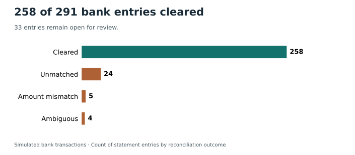
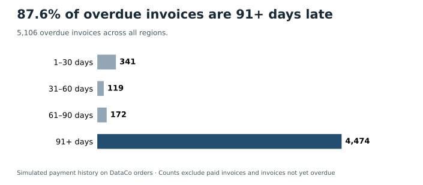

# Cross-Border Finance Operations

A step-by-step finance operations analysis for a fictional, cross-border medical-device manufacturer, MediRobo Diagnostics. The project combines public supply-chain order and shipping data with a synthetic finance layer to demonstrate accounts receivable (AR), accounts payable (AP), payment-risk analysis, bank reconciliation, internal controls, and employee reimbursements.


## Open the dashboard

Extract the ZIP and open [dashboard.html](dashboard.html) in a browser. The three views work offline from one HTML file. Use the navigation at the top to switch workflows.

| View | What to look for | Source |
| --- | --- | --- |
| Supply chain & receivables | Compare overdue invoice counts by age and region. The 87.6% figure uses overdue invoices as its denominator. | AR aging export and notebook shipping analysis |
| Customer payment risk | Read precision and recall together. The model caught 68% of overdue cases in the holdout set, while only 10% of flagged cases were overdue. | Notebook classification report and statistical tests on simulated payment labels |
| Finance operations controls | Use the exception filter to inspect unmatched entries, amount mismatches, or ambiguous candidates. Compare bank and ledger IDs and the signed variance. | Reconciliation, payables and reimbursement outputs |

## From source data to the dashboard

1. **Prepare orders.** The notebook reads DataCo order lines, groups them by order ID and checks that order-level sales and invoice values sum to the original line totals.
2. **Calculate receivables.** It assigns simulated payment terms and payment dates, then uses a reporting date and SQLite queries to classify open invoices by region and age.
3. **Evaluate payment risk.** Paid and overdue orders supply the model labels. A stratified holdout produces the precision, recall and ROC-AUC shown on the risk page.
4. **Reconcile cash and enforce controls.** A separate simulation creates bank, ledger, vendor and reimbursement records. Matching rules clear eligible entries and send unresolved cases to review. The investor-deposit module demonstrates account- and reference-based matching on a separate test fixture.
5. **Publish the findings.** The notebook writes CSV reports to `exports/` and saves model results in the notebook. The HTML and SVG figures are snapshots of the included run. Opening the dashboard reads its embedded figures and rows.

To reproduce the bundled visualizations, run the following commands from the extracted project folder after installing the notebook dependencies:

```bash
python scripts/build_snapshots.py
python scripts/build_dashboard.py
```

The dashboard builder reads the CSV exports and checks the saved model output. Its interpretation text and selected model and shipping figures describe the bundled run. If you change the data or model, review those values in the builder before sharing the regenerated dashboard.

## Findings from the simulated finance data



[View the bank reconciliation results](exports/reconciliation_matches.csv)



[View the receivables aging report](exports/ar_aging_report.csv)

## Project at a glance

The notebook, [Morphle_FinOps_Project.ipynb](./Morphle_FinOps_Project.ipynb), runs three connected workflows:

1. **Supply chain and AR:** clean and summarize order and delivery data, simulate customer payment terms, and produce regional AR aging and delivery analyses.
2. **Customer payment risk:** test whether overdue payments vary across customer segments and regions, then evaluate a logistic-regression classifier.
3. **Finance operations controls:** generate example vendor, bank, ledger, and reimbursement records; analyze AP and currency exposure; reconcile transactions; and flag control exceptions.

The final notebook section exports the key reports as CSV files.

## Repository contents

| Path | Description |
| --- | --- |
| `Morphle_FinOps_Project.ipynb` | Main notebook containing the analysis and workflow. |
| `DataCoSupplyChainDataset.csv` | Required public supply-chain source data (approximately 180,000 rows). |
| `ar_aging_report.csv`, `vendor_invoices.csv`, etc. | Example finance reports supplied with the project. The notebook generates its own reports under `exports/`. |
| `exports/` | Output directory created by the final notebook cell. |

## Requirements

- Python 3.10 or newer
- Jupyter Notebook or JupyterLab
- The notebook packages listed below
- The source file `DataCoSupplyChainDataset.csv` in the project root, next to the notebook

Install the dependencies in your Python environment:

```bash
python -m pip install pandas numpy scipy scikit-learn matplotlib jupyter
```

## Run the notebook

1. **Get the project files.** Clone or download this repository, and ensure `DataCoSupplyChainDataset.csv` is in the same folder as the notebook.
2. **Open a terminal in the project folder.** This matters because the notebook loads the dataset using a relative path.
3. **Install dependencies** using the command above.
4. **Start Jupyter:**

   ```bash
   jupyter notebook
   ```

   Alternatively, use `jupyter lab` if you prefer JupyterLab.
5. **Open `Morphle_FinOps_Project.ipynb`.** Select the Python environment where you installed the dependencies.
6. **Run every cell from top to bottom.** The analyses build on dataframes and tables created earlier in the notebook; running sections out of order may fail.
7. **Review results** in each section and find the generated CSV reports in the new `exports/` directory.

The notebook uses fixed NumPy, Python `random`, and synthetic-data seeds to make its synthetic examples more reproducible. Model results can still depend on library versions and execution environment.

## Workflows, step by step

### 1. Supply chain and accounts receivable

1. Load the DataCo supply-chain CSV and parse order and shipping dates.
2. Map source markets into illustrative business regions: `USCA` to `USA`, `Pacific Asia` to `India & APAC`, and `Africa` to `Middle East & Africa`. These names are a storytelling convention, not a correction to the source data.
3. Create distinct order, customer, and product tables, then load the analysis tables into an in-memory SQLite database.
4. Add a **simulated AR layer** to the real orders: regional payment terms, due dates, and seeded sample payment behavior. The source dataset does not contain invoice payment history.
5. Use SQL to summarize AR aging by region and to compare late deliveries by region and shipping mode, alongside regional profitability/landed-cost analyses.

### 2. Customer payment risk

1. Build a customer/order analysis dataset from the prepared orders and the simulated AR outcomes.
2. Use statistical tests to examine the relationship between overdue status and customer region, customer segment, and order value.
3. Fit a logistic-regression classifier using a train/test split.
4. Review the ROC-AUC and classification report to understand the model's test-set performance.

The risk labels are generated for demonstration; model metrics are not evidence of real customer default risk.

### 3. AP, reconciliation, controls, and reimbursements

1. Generate sample vendors and multi-currency vendor invoices, then summarize payables by status and currency.
2. Apply illustrative exchange rates to estimate open payable exposure in INR.
3. Generate sample bank statement and internal-ledger transactions. Match candidates by amount and date window, then screen by token-sorted description similarity (85/100 minimum, Python standard library). Only an uncontested one-to-one link with zero monetary variance clears.
4. Separate matched entries from unmatched bank and ledger entries.
5. Apply the sample internal-control rules to flag transactions requiring review and stale unreconciled entries.
6. Generate employee reimbursement claims and evaluate them against the configured checks, such as missing receipts and review timing.

These records and control outcomes are synthetic examples created in the notebook; they are not loaded from the similarly named sample CSVs in the project root.

## Generated reports

When the final export cell completes, `exports/` contains:

| File | Contents |
| --- | --- |
| `ar_aging_report.csv` | Open AR summarized by region and aging bucket. |
| `vendor_invoices.csv` | Simulated vendor invoices with amounts, currencies, due dates, and payment status. |
| `reimbursement_claims.csv` | Simulated employee claims and processing/control status. |
| `reconciliation_matches.csv` | Bank transactions and their proposed ledger matches, including match quality. |
| `reconciliation_unmatched_bank.csv` | All uncleared bank entries, including ambiguous candidates and linked amount mismatches. |
| `reconciliation_open_ledger.csv` | All uncleared ledger entries. |
| `internal_controls.csv` | The sample control rules and their thresholds. |

The notebook also displays additional analysis tables and metrics interactively; not every displayed intermediate result is exported.

## Data sources and interpretation

The supply-chain portion uses the DataCo dataset for order, product, customer, and shipping information. The notebook layers generated finance assumptions on top of those orders because the public dataset does not provide AR payment histories, vendor invoices, bank statements, or employee reimbursements. Regional payment terms, simulated payment behavior, foreign-exchange rates, vendor records, bank/ledger transactions, and reimbursement claims should all be treated as illustrative assumptions.

The market mapping does not make the DataCo dataset representative of Morphle Labs' real customers or geographic footprint. No company financial records are used or implied.

## Investor deposit reconciliation and acceptance tests

From the extracted project folder, run these with Python 3.10+ (standard library only):

    python -m investor_deposits.workflow
    python -m unittest investor_deposits.test_workflow -v

The same demo is available in the notebook's final section. Inputs are small, simulated bank and investor-ledger records. The example uses INR in integer paise. The matching policy requires identical account, reference and currency, with posting dates within five calendar days inclusive. A unique pair with an amount difference stays open with the signed bank-minus-ledger variance. Competing claims remain ambiguous. Re-importing identical IDs and contents is idempotent. A changed record under the same source ID rejects that batch.

| Acceptance scenario | Expected result |
|---|---|
| Two investors expect ₹5,000 on the same day; only investor B's deposit arrives | Clear B; leave A's ledger entry open, independent of row order. |
| Bank shows ₹5,000; same investor and reference show ₹4,950 in the ledger | Link the pair for review with +5,000 paise variance. |
| Same statement imported twice | Zero new bank rows and identical reconciliation results. |
| A second distinct bank record claims the same ledger deposit | Both claims remain open. |

Each SQL file in investor_deposits/checks returns offending rows. Tests introduce a duplicate clearance, an incorrect clearance and a missing outcome to confirm the three controls detect bad data. See [the defect report](investor_deposits/defect_report.md) for the original mismatch and its regression test.
